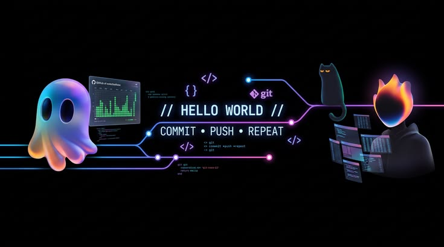

  

<h1 align="center">Zille Tabia Azam</h1>

<strong>SIEM Engineer || SOC || Elastic Security || Observability || CNSP || CAP || AI Agents &amp; Automation || R&amp;D</strong>

  
  

 

## Featured projects

- **OBS Portal** (private work project, no public repo): An Elasticsearch-backed observability portal I built with service and infrastructure topology views that map dependencies between hosts and services, plus blast-radius analysis from any node.
- **[Smart Grow](https://github.com/zilleazam/smart-grow)**: My AI + IoT final-year project for plant health monitoring, CNN leaf-disease detection, and greenhouse automation. The repo has the Python GUI, the ML models, the Arduino firmware, and photos of the system.

## Cybersecurity write-ups on Medium

Published in [InfoSec Write-ups](https://infosecwriteups.com/):

- [Basic Malware Analysis & Incident Response: A Hands-On Walkthrough with a WannaCry Variant](https://infosecwriteups.com/basic-malware-analysis-incident-response-a-hands-on-walkthrough-with-a-wannacry-variant-bc2ae6517228)
- [Virus Detection through pfSense & Log Forwarding to Wazuh](https://infosecwriteups.com/virus-detection-through-pfsense-log-forwarding-to-wazuh-bf35418ee785)
- [pfSense Installation and Configuration Guide](https://infosecwriteups.com/pfsense-installation-and-configuration-71559299dd7b)

**[All write-ups on Medium →](https://medium.com/@zilleazam)**

## Tools

  
  
  
  
  
  
  

## Contact

[LinkedIn](https://www.linkedin.com/in/zilletabia/) · [Medium](https://medium.com/@zilleazam)
